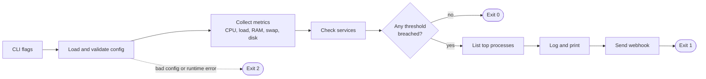

<div align="center">


<br>


**Zero dependencies. Cron-native. Silent when healthy, loud when it matters.**

[Quick start](#-quick-start) · [Features](#-features) · [Configuration](#%EF%B8%8F-configuration) · [CLI](#-cli-reference) · [Automation](#-run-it-automatically) · [No Ubuntu?](#-no-linux-machine) · [Testing](#-testing)

</div>

---

## ✨ Why sysguard?

Most monitoring stacks want an agent, a database and a dashboard. Sometimes you just need one
script that checks your box, tells you when something is wrong, and gets out of the way.

|  |  |
|---|---|
| 📦 **Zero dependencies** | Pure Bash plus tools already on your system: `awk`, `df`, `ps`, `curl` |
| ⏰ **Cron-native** | `--quiet` mode produces output only when an anomaly occurs |
| 🔌 **Pipeline-friendly** | Strict exit codes and valid JSON for CI/CD and wrapper scripts |
| 🔒 **Safe by design** | Config is parsed, never executed; webhook URL never appears in `ps` |

## 🚀 Quick start

```bash
git clone https://github.com/<your-username>/sysguard.git
cd sysguard

cp config/sysguard.conf.example config/sysguard.conf
chmod 600 config/sysguard.conf        # may contain a webhook secret

./bin/sysguard.sh --dry-run           # safe first run: no logs, no webhooks
```

> [!TIP]
> Want to see an alert fire? Set `MEM_THRESHOLD=1` in your config and run it again.

<details>
<summary><b>System-wide install</b></summary>

```bash
sudo install -m 0755 bin/sysguard.sh /usr/local/bin/sysguard
sudo install -d /etc/sysguard
sudo install -m 0600 config/sysguard.conf.example /etc/sysguard/sysguard.conf
sysguard --config /etc/sysguard/sysguard.conf
```

</details>

**Requirements:** `bash` 3.2+ (the macOS default works), `awk`, `sed`, `sort`, `df`, `ps`, and `curl` for
webhooks. `pgrep` is used for service checks when systemd isn't available.

## 🎯 Features

| | Feature | Details |
|---|---|---|
| 🧠 | **CPU** | Usage % sampled over a window, plus 1/5/15-minute load averages |
| 💾 | **Memory** | RAM and swap usage % |
| 💽 | **Disk** | Usage % for one or many mount points |
| 🔧 | **Services** | `systemctl is-active` on systemd hosts, `pgrep` everywhere else |
| 🔥 | **Culprits** | Top 3 CPU and memory processes, listed automatically on alert |
| 🎨 | **Output** | Timestamped and color-coded in a terminal; plain text in the log file |
| 🔔 | **Webhooks** | Slack and Discord compatible payloads sent with `curl` |
| 🤖 | **JSON** | Machine-readable output via `--json` |
| 🧪 | **Tested** | 64 automated tests, ShellCheck clean |

## 👀 What it looks like

```text
$ sysguard --config /etc/sysguard/sysguard.conf
2026-11-17 05:57:27 [INFO ] sysguard 1.0.0 on web-01 (Linux)
2026-11-17 05:57:27 [OK   ] CPU usage 3.2% (threshold 80%)
2026-11-17 05:57:27 [INFO ] Load average (1m/5m/15m): 0.42 0.38 0.3
2026-11-17 05:57:27 [ALERT] Memory usage is 91.4% (threshold 80%)
2026-11-17 05:57:27 [OK   ] Swap usage 0.0% (threshold 50%)
2026-11-17 05:57:27 [OK   ] Disk usage on / 45% (threshold 85%)
2026-11-17 05:57:27 [ALERT] Service 'docker' is not running
2026-11-17 05:57:27 [INFO ] Top CPU #1: node (pid 3564, cpu 12.7%, mem 4.1%)
2026-11-17 05:57:27 [INFO ] Top memory #1: java (pid 65, cpu 3.0%, mem 38.7%)
2026-11-17 05:57:27 [ALERT] 2 alert(s) triggered
```

## 🧩 How it works



## ⚙️ Configuration

Copy `config/sysguard.conf.example` and edit it. The format is plain `KEY=VALUE`; quotes and
`# comments` are allowed, unknown keys are rejected, and nothing is ever executed.

| Setting | Default | Description |
|---|---|---|
| `CPU_THRESHOLD` | `80` | Alert when CPU usage is above this % |
| `MEM_THRESHOLD` | `80` | Alert when RAM usage is above this % |
| `SWAP_THRESHOLD` | `50` | Alert when swap usage is above this % |
| `DISK_THRESHOLD` | `85` | Alert when disk usage is above this % |
| `DISK_PATH` | `/` | Mount point(s), comma-separated: `/,/var,/home` |
| `LOG_FILE` | `$TMPDIR/sysguard.log` | Plain-text log (use `/var/log/sysguard.log` for system installs) |
| `WEBHOOK_URL` | *(empty)* | Slack/Discord incoming webhook; empty disables notifications |
| `SERVICES_TO_CHECK` | *(empty)* | Comma-separated, e.g. `ssh,cron,docker` |
| `CPU_SAMPLE_SECONDS` | `1` | Length of the CPU sampling window |

**Config lookup order** (first match wins): `--config <path>` → `$SYSGUARD_CONFIG` →
`config/sysguard.conf` next to the script → `/etc/sysguard/sysguard.conf` → built-in defaults.
An explicitly given config that doesn't exist is an error (exit `2`).

> [!NOTE]
> **Service names:** with systemd, use unit names (`ssh` on Debian, `sshd` on RHEL). Otherwise names
> are matched against process names with `pgrep -x name`, then `named`.

> [!WARNING]
> Keep your real `config/sysguard.conf` out of Git and run `chmod 600` on it. It is already in `.gitignore`.

## 🖥️ CLI reference

| Flag | What it does |
|---|---|
| `--config <path>` | Use a specific config file |
| `--dry-run` | Print results only: no log writes, no webhook calls |
| `--json` | Emit metrics as JSON on stdout |
| `--quiet`, `-q` | Produce output (and log entries) only when an alert triggers |
| `--version` | Print the version |
| `--help`, `-h` | Show help |

### Exit codes

| Code | Meaning | Typical reaction |
|---|---|---|
| `0` | ✅ Healthy | nothing to do |
| `1` | ⚠️ Threshold breached or service down | alert, page, fail the pipeline |
| `2` | ❌ Configuration or runtime error | fix the setup |

```bash
sysguard --config /etc/sysguard/sysguard.conf --quiet
case $? in
  0) echo "healthy" ;;
  1) echo "needs attention" ;;
  2) echo "sysguard itself is misconfigured" ;;
esac
```

## 🤖 JSON output

```bash
sysguard --json --dry-run | jq '.status, .memory.usage_percent'
```

<details>
<summary><b>Full example</b></summary>

```json
{
  "timestamp": "2026-11-17T05:57:27Z",
  "hostname": "web-01",
  "os": "Linux",
  "status": "alert",
  "cpu": {"usage_percent": 3.2, "threshold": 80},
  "load_average": {"1m": 0.42, "5m": 0.38, "15m": 0.3},
  "memory": {"usage_percent": 91.4, "threshold": 80},
  "swap": {"usage_percent": 0.0, "threshold": 50},
  "disks": [
    {"path": "/", "usage_percent": 45, "threshold": 85}
  ],
  "services": [
    {"name": "docker", "status": "down"}
  ],
  "alerts": [
    "Memory usage is 91.4% (threshold 80%)",
    "Service 'docker' is not running"
  ],
  "top_processes": {
    "cpu": [{"pid": 3564, "cpu_percent": 12.7, "mem_percent": 4.1, "command": "node"}],
    "memory": [{"pid": 65, "cpu_percent": 3.0, "mem_percent": 38.7, "command": "java"}]
  }
}
```

</details>

## 🔔 Webhook alerts

Set `WEBHOOK_URL` to a Slack or Discord incoming webhook. On any alert, sysguard POSTs:

```json
{"text": "...", "content": "..."}
```

`text` is read by Slack and `content` by Discord. A failed delivery is logged as a warning and does
not change the exit code. The URL is passed to `curl` over stdin, so it never shows up in the process list.

## ⏰ Run it automatically

```cron
# Every 5 minutes. Silent when healthy; cron emails you only when an alert fires.
*/5 * * * * /usr/local/bin/sysguard --config /etc/sysguard/sysguard.conf --quiet
```

Prefer webhooks over email? Silence cron and let the webhook do the talking:

```cron
*/5 * * * * /usr/local/bin/sysguard --config /etc/sysguard/sysguard.conf --quiet >/dev/null 2>&1
```

> [!TIP]
> Cron email needs working mail on the host (`MAILTO=you@example.com` at the top of the crontab).
> Cron also runs with a minimal `PATH`, so add `PATH=/usr/local/bin:/usr/bin:/bin` if `curl` or
> `pgrep` aren't found. Rotate the log with `logrotate` (for example weekly, `rotate 4`, `compress`).

## 🐧 No Linux machine?

sysguard needs Linux or macOS. Pick whichever of these fits:

| Your setup | Easiest option |
|---|---|
| **Windows 10/11** | Install WSL: run `wsl --install` in an admin PowerShell, restart, then run sysguard in the Ubuntu terminal |
| **Any browser** | [Google Cloud Shell](https://shell.cloud.google.com) or GitHub Codespaces: upload or clone the repo and run it |
| **Docker installed** | See the command below |
| **macOS** | Works directly in Terminal |

```bash
docker run --rm -it -v "$PWD":/work -w /work ubuntu:24.04 bash
apt-get update && apt-get install -y procps
./bin/sysguard.sh --dry-run
```

> [!NOTE]
> Git Bash and Cygwin on Windows are not supported; sysguard exits with an "unsupported operating system" error there.

## 🧪 Testing

```bash
./tests/test_sysguard.sh              # 64 tests
shellcheck -x bin/sysguard.sh tests/test_sysguard.sh
```

The suite covers CLI flags, config validation, JSON validity, `--dry-run`, `--quiet`, threshold
breaches, service checks and webhook behaviour. It uses temporary configs and a stubbed `curl`,
so nothing touches the network.

## 🗂️ Project layout

```text
sysguard/
├── assets/
│   └── banner.svg                # README banner
├── bin/
│   └── sysguard.sh               # the monitor
├── config/
│   └── sysguard.conf.example     # copy to sysguard.conf (git-ignored)
├── tests/
│   └── test_sysguard.sh          # automated test suite
├── README.md
├── LICENSE
└── .gitignore
```

## 🗺️ Roadmap

- [x] CPU, load, memory, swap, disk and service checks
- [x] JSON output, `--quiet` and `--dry-run`
- [x] Slack/Discord webhooks
- [x] Automated test suite
- [ ] Per-metric alert cooldown to avoid repeat notifications
- [ ] GitHub Actions workflow running the tests and ShellCheck
- [ ] Optional Prometheus text-file output

## 🤝 Contributing

Issues and pull requests are welcome. Please run the test suite and ShellCheck first, and use
[Conventional Commits](https://www.conventionalcommits.org/) (`feat:`, `fix:`, `docs:`, `test:`).

## 📄 License

Released under the [MIT License](LICENSE).

<div align="center">

If sysguard saves you a 3 a.m. surprise, consider giving it a ⭐
QYYF6S
</div>
